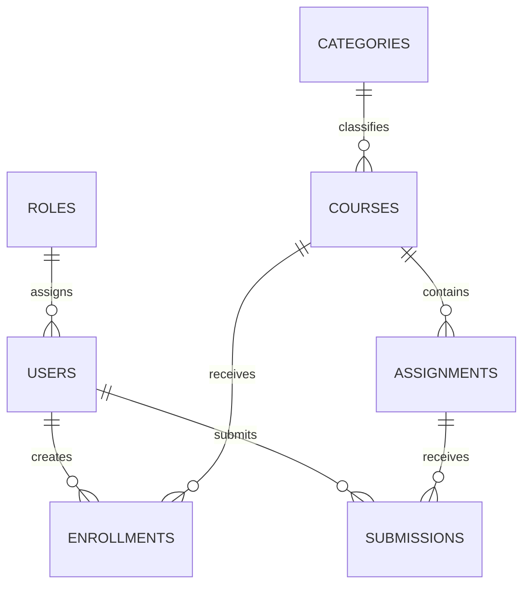

<div align="center">

# PostgreSQL Database Testing

**SQL analysis and database QA for an online learning platform**

7 tables · 8 analytical queries · 15 documented test cases


I built a small learning-platform database, queried its data, and tested whether its constraints protect data integrity.

**[Explore the queries](#sql-and-qa-coverage)** · **[See the finding](#documented-finding)** · **[Run the project](#run-the-project)**

</div>

## Project at a glance

- **SQL analysis:** eight queries use sorting, joins, aggregation, and a subquery to answer questions about courses, enrollments, scores, and revenue.
- **Database QA:** 15 cases cover `NOT NULL`, `UNIQUE`, `PRIMARY KEY`, `FOREIGN KEY`, and `DEFAULT` behavior.
- **Original assignment results:** 13 PASS and 2 FAIL. Both failures concerned the default course level. The schema in this repository includes the correction and regression checks; a new execution result is not recorded here.

## SQL and QA coverage

The [analytical queries](queries/learning-platform-queries.sql) include students per course, average assignment scores, course revenue, and users with no submissions. The [test cases](reports/database-test-cases.md) state each operation, expected result, and original assignment outcome. The runnable [SQL test suite](tests/run-all-tests.sql) checks both rejected invalid inserts and existing data for constraint violations.

## Documented finding

The original execution recorded a course inserted without `level` as `NULL`, although the expected value was `Beginner`. This affected **TC-DB-014** and **TC-DB-015**. The repository [schema](database/01-schema.sql) now defines `level VARCHAR(30) NOT NULL DEFAULT 'Beginner'`, and the [default tests](tests/05-default-tests.sql) check the corrected behavior. See the [execution summary](reports/execution-summary.md) for the original result.

## Database model

The sample platform connects roles, users, categories, courses, enrollments, assignments, and submissions:



Emails are required and unique; enrollments and submissions cannot duplicate the same user-course or user-assignment pair. The schema also checks nonnegative prices and scores. Sample records are reproducible project fixtures, not the original assignment data.

## Project files

- [Schema](database/01-schema.sql) · [Sample data](database/02-seed-data.sql) · [Baseline integrity checks](database/03-verification.sql)
- [Analytical queries](queries/learning-platform-queries.sql) · [Constraint test suite](tests/run-all-tests.sql)
- [Test cases](reports/database-test-cases.md) · [Original execution summary](reports/execution-summary.md)

## Run the project

Create a dedicated PostgreSQL database named `learning_platform`, then run these commands from the repository root. **The schema script drops and recreates the project's tables**, so use a practice database.

```bash
psql -U postgres -d learning_platform -f database/01-schema.sql
psql -U postgres -d learning_platform -f database/02-seed-data.sql
psql -U postgres -d learning_platform -f database/03-verification.sql
psql -U postgres -d learning_platform -f queries/learning-platform-queries.sql
psql -U postgres -d learning_platform -f tests/run-all-tests.sql
```

In pgAdmin, run the schema, seed data, verification, and query files in that order; then run the five numbered SQL files in `tests/` individually. The `run-all-tests.sql` wrapper uses `psql` commands and cannot be pasted into pgAdmin Query Tool as-is.
