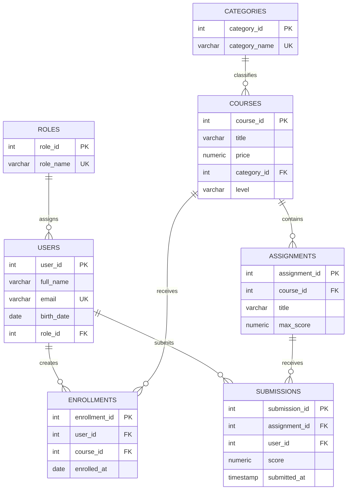

# Data Model

## Design Notes

- `users.email` is mandatory and unique.
- Every user references an existing role.
- Every course references an existing category.
- `courses.level` is mandatory and defaults to `Beginner`.
- A user may enroll in a course only once.
- A user may submit each assignment only once.
- Submission scores cannot be negative.
